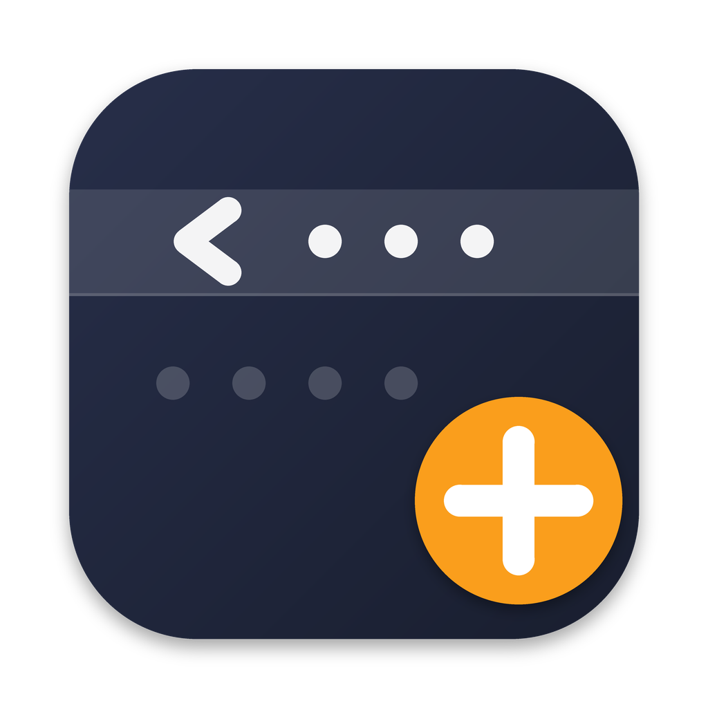

<p align="center">
	
</p>
<p align="center">
	<a href="https://github.com/SumOfOneInteger/HiddenBarPlus/releases/latest">
		
	</a>
	
	
</p>

# Hidden Bar Plus

Hidden Bar Plus hides menu bar items to give your Mac a cleaner look.

It is an independently maintained fork of [Hidden Bar](https://github.com/dwarvesf/hidden)
by [Dwarves Foundation](https://github.com/dwarvesf), distributed outside the
Mac App Store so that it keeps working on macOS 27 and later.

<p align="center">
	
	
</p>

## Why a fork

- **Works on macOS 27.** macOS 27 ejects the over-wide separator that Hidden Bar
  used to push icons off-screen. Hidden Bar Plus ships upstream's native hiding
  engine, which asks macOS itself to hide the icons. That engine needs the
  Accessibility permission and cannot run inside the App Store sandbox, which is
  why this app is a direct download only.
- **Auto-updates.** A built-in [Sparkle](https://sparkle-project.org) updater:
  *Check for Updates…* in the context menu, plus optional automatic checks.
- **One build.** No App Store scheme, no sandbox entitlement, nothing to pick.

Hidden Bar Plus has its own bundle identifier (`com.sumofoneinteger.hiddenbarplus`),
so it installs next to Hidden Bar and starts with fresh preferences.

## Install

Requires macOS 13 Ventura or later. On macOS 13 to 26 it behaves like Hidden
Bar; the native engine takes over on macOS 27.

1. Download the latest build from
   [Releases](https://github.com/SumOfOneInteger/HiddenBarPlus/releases/latest).
2. Drag **Hidden Bar Plus.app** into `/Applications` and launch it.
3. On macOS 27, grant Accessibility when asked
   (System Settings › Privacy & Security › Accessibility).

A Homebrew cask (`brew install --cask hidden-bar-plus`) is planned; until it is
published, use the manual download.

## Usage

- `⌘` + drag to move icons around in the menu bar. Icons to the left of the
  arrow are hidden when the bar is collapsed.
- Click the arrow to hide or show them. Right-click it for the context menu
  (Preferences, auto-collapse, Check for Updates…, Quit).

<p align="center">
	
</p>

## Documentation

- [Manual](docs/MANUAL.md): every setting, the Terminal-only options, and troubleshooting.
- [Architecture](docs/ARCHITECTURE.md): how the hiding trick works, topology, and known limits.
- [Maintainer runbook](docs/RUNBOOK.md): build, verify, sign, notarize and publish a release.
- [Backlog](docs/BACKLOG.md): open work inherited from upstream.

## Building from source

Xcode 26 or later on macOS 13+. Dependencies (HotKey, Sparkle) are Swift
packages and resolve on first build.

```sh
# build without signing
xcodebuild -project 'Hidden Bar Plus.xcodeproj' -scheme 'Hidden Bar Plus' \
  -configuration Debug CODE_SIGNING_ALLOWED=NO build

# unit tests (HiddenBarTests + HiddenTests)
xcodebuild -project 'Hidden Bar Plus.xcodeproj' -scheme 'Hidden Bar Plus' \
  -destination 'platform=macOS' CODE_SIGNING_ALLOWED=NO test
```

To run it from Xcode, open the project, select the *Hidden Bar Plus* target and
pick your team under *Signing & Capabilities*; the project ships with no team set.

## Credits

Hidden Bar Plus is based on [Hidden Bar](https://github.com/dwarvesf/hidden),
© 2019 Dwarves Foundation, including its macOS 27 native hiding engine and its
translations by the Hidden Bar community. Thank you.

Contributions are welcome; please read [CONTRIBUTING.md](CONTRIBUTING.md) first.

## License

MIT. Copyright © 2026 SumOfOneInteger; original work copyright © 2019 Dwarves
Foundation. See [LICENSE](LICENSE).
